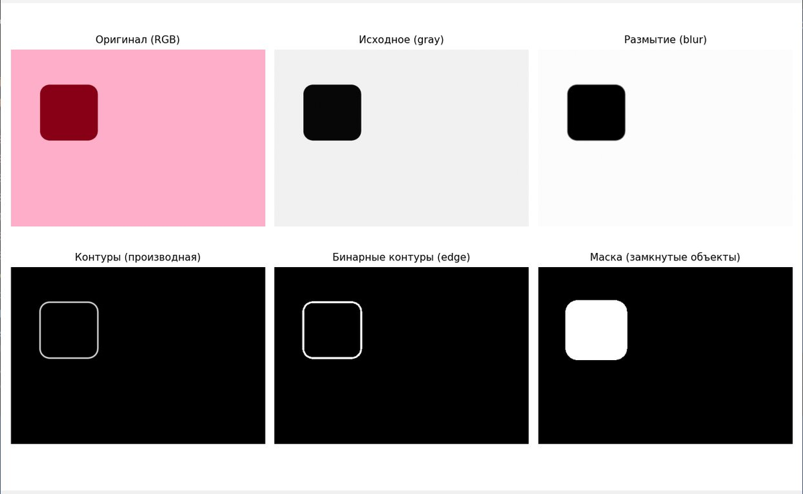
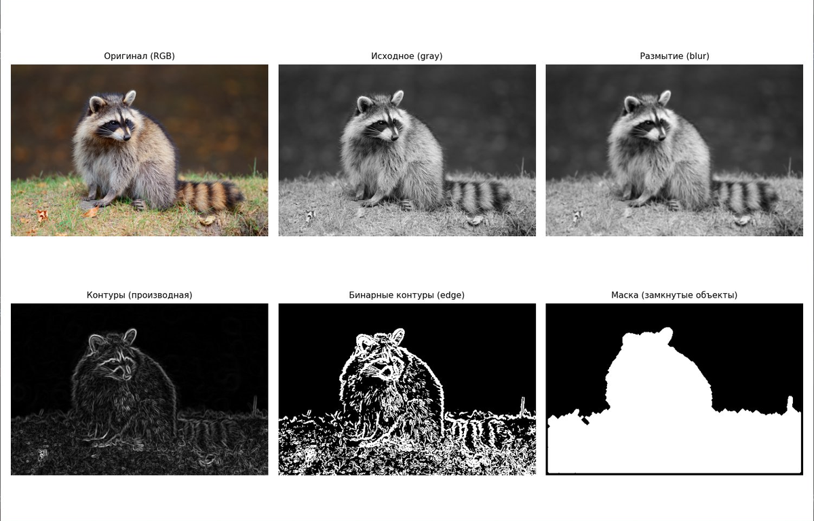
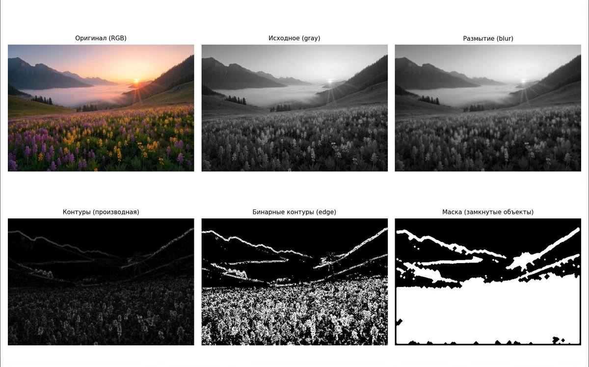

# Window Transform Object Masking

Выделение объектов на двумерном изображении методом оконного (матричного) преобразования. Проект реализует полный конвейер классического компьютерного зрения: сглаживание, повышение резкости, выделение контуров, пороговую бинаризацию и морфологическую постобработку с получением бинарной маски объектов.

| | |
|---|---|
| **Язык** | Python 3 |
| **Стек** | NumPy, Pillow, SciPy, Matplotlib |
| **Задача** | Object extraction / binary mask from image |
| **Подход** | Sequential convolution filters (window transforms) |

---

## Возможности

- Реализация оконного преобразования (свёртки) «с нуля» без OpenCV
- Ядра размытия: простое усреднение $3 \times 3$ и Гаусс $7 \times 7$
- Ядра контуров: лапласиан 4-/8-связный и операторы Собеля
- Повышение резкости (Laplacian sharpening)
- Автоподбор комбинации blur / edge / threshold по контрасту маски
- Визуализация всех этапов пайплайна

---

## Быстрый старт

```bash
git clone https://github.com/<your-username>/window-transform-object-masking.git
cd window-transform-object-masking

python -m venv .venv
# Windows:
.venv\Scripts\activate
# Linux / macOS:
# source .venv/bin/activate

pip install -r requirements.txt
python object_mask_extraction.py path/to/image.jpg
```

Полезные флаги:

```bash
# Сохранить визуализацию без открытия окна
python object_mask_extraction.py input.jpg --save assets/my_result.png --no-show

# Отключить резкость или усилить её
python object_mask_extraction.py input.jpg --sharpen 0
python object_mask_extraction.py input.jpg --sharpen 2.0
```

---

## Постановка задачи

Машинное зрение анализирует визуальные данные. Одна из базовых задач - **выделение объектов**: автоматически определить, какие пиксели принадлежат объекту, а какие - фону.

Результат - **бинарная маска** того же размера, что и исходное изображение:

- $1$ - пиксель принадлежит объекту;
- $0$ - пиксель принадлежит фону.

Главный признак объекта - его **контур**: граница, на которой яркость резко изменяется. На одномерном сечении яркость $I(x)$ образует плоские участки (фон, тело объекта) и крутые перепады на контурах. Именно там производная $\dfrac{dI}{dx}$ велика. Двумерное обобщение этого принципа лежит в основе метода.

Сложность зависит от контраста сцены: тёмный объект на однородном фоне выделяется легко; животное на природном фоне - заметно сложнее. Здесь используется класс **фильтрационных** алгоритмов: последовательные матричные операторы без априорного знания о форме объектов.

---

## Теория

### 1. Оконное (матричное) преобразование

Оконное преобразование заменяет каждый пиксель взвешенной суммой яркостей в его окрестности. Пусть исходный пиксель - $P(x, y)$. Тогда преобразованный пиксель:

$$
P'(x, y) = \sum_{m} C_m \cdot P_m(x, y)
$$

где:

- суммирование ведётся по всем ячейкам $m$ оконной матрицы;
- $C_m$ - коэффициент (вес) ячейки $m$;
- $P_m(x, y)$ - яркость пикселя в позиции $m$ окна, центрированного на $(x, y)$.

Матрица коэффициентов $\{C_m\}$ называется **ядром свёртки** (фильтром). Размер окна ($3 \times 3$, $5 \times 5$, $7 \times 7$, ...) задаёт область влияния. Каждый пиксель обрабатывается независимо.

Порядок вычислений:

1. Изображение дополняется по краям (**padding**, режим `edge` - копирование крайних пикселей).
2. Окно последовательно центрируется на каждом пикселе.
3. Для каждой позиции считается взвешенная сумма по формуле выше.
4. Итог при необходимости нормируется в диапазон $[0, 255]$.

Нормировка яркости:

$$
I_{\mathrm{norm}} = \frac{I - I_{\min}}{I_{\max} - I_{\min}} \cdot 255
$$

Преобразования можно выстраивать в цепочку: выход одного фильтра - вход следующего. Так от исходного изображения переходят к карте контуров, а затем к бинарной маске.

### 2. Матрицы размытия (blur)

Размытие подавляет высокочастотный шум и мелкие детали: яркость пикселя заменяется средневзвешенным значением соседей.

**Простое (взвешенное) усреднение** $3 \times 3$:

$$
K_{\mathrm{blur}} = \frac{1}{16}
\begin{bmatrix}
1 & 2 & 1 \\
2 & 4 & 2 \\
1 & 2 & 1
\end{bmatrix}
$$

Делитель $16$ равен сумме коэффициентов и нормирует ядро так, что результат - взвешенное среднее. Центр имеет вес $4$, соседи по сторонам - $2$, угловые - $1$.

**Размытие по Гауссу.** Коэффициенты убывают с расстоянием от центра по закону нормального распределения:

$$
G(x, y) = \exp\left(-\frac{x^{2} + y^{2}}{2\sigma^{2}}\right)
$$

После вычисления коэффициентов ядро нормируется:

$$
K_{\mathrm{gauss}}(x, y) = \frac{G(x, y)}{\sum_{i,j} G(i, j)}
$$

Параметр $\sigma$ задаёт «радиус» размытия. При $\sigma = 1.5$ и размере ядра $7 \times 7$ получается плавный переход весов от максимума в центре к минимуму на краях.

### 3. Повышение резкости (sharpening)

Резкость усиливает высокочастотные детали (обратная идея к blur). Базовая схема unsharp / Laplacian sharpening:

$$
I_{\mathrm{sharp}} = I + s \cdot (I - I_{\mathrm{blur}}) = (1 + s)\, I - s\, I_{\mathrm{blur}}
$$

Эквивалентное ядро $3 \times 3$ при силе $s$:

$$
K_{\mathrm{sharp}}(s) =
\begin{bmatrix}
0 & -s & 0 \\
-s & 1 + 4s & -s \\
0 & -s & 0
\end{bmatrix}
$$

При $s = 1$:

$$
K_{\mathrm{sharp}}(1) =
\begin{bmatrix}
0 & -1 & 0 \\
-1 & 5 & -1 \\
0 & -1 & 0
\end{bmatrix}
$$

При $s = 2$:

$$
K_{\mathrm{sharp}}(2) =
\begin{bmatrix}
0 & -2 & 0 \\
-2 & 9 & -2 \\
0 & -2 & 0
\end{bmatrix}
$$

После применения резкости значения клиппируются в $[0, 255]$.

### 4. Матрицы выделения контуров

После сглаживания применяется матрица дифференцирования. У таких ядер **сумма коэффициентов равна нулю**: на однородном участке отклик $\approx 0$, на контуре - большой по модулю.

**Лапласиан 4-связный** (вторая производная по четырём направлениям):

$$
K_{L4} =
\begin{bmatrix}
0 & -1 & 0 \\
-1 & 4 & -1 \\
0 & -1 & 0
\end{bmatrix}
$$

**Лапласиан 8-связный** (все 8 соседей, включая диагонали):

$$
K_{L8} =
\begin{bmatrix}
-1 & -1 & -1 \\
-1 & 8 & -1 \\
-1 & -1 & -1
\end{bmatrix}
$$

**Операторы Собеля** - аппроксимация первых частных производных:

$$
S_x =
\begin{bmatrix}
-1 & 0 & 1 \\
-2 & 0 & 2 \\
-1 & 0 & 1
\end{bmatrix},
\qquad
S_y =
\begin{bmatrix}
-1 & -2 & -1 \\
0 & 0 & 0 \\
1 & 2 & 1
\end{bmatrix}
$$

Комбинированный градиент Собеля:

$$
|G| = \sqrt{G_x^{2} + G_y^{2}},
\qquad
G_x = I * S_x,\quad
G_y = I * S_y
$$

где $*$ обозначает оконное преобразование (свёртку).

### 5. Цепочка преобразований и построение маски

Полный пайплайн:

**Шаг 1. Сглаживание.** К серому изображению $I$ применяется ядро размытия:

$$
I_{\mathrm{blur}} = I * K_{\mathrm{blur}}
\quad \text{или} \quad
I_{\mathrm{blur}} = I * K_{\mathrm{gauss}}
$$

**Шаг 2. Резкость.** К сглаженному изображению применяется $K_{\mathrm{sharp}}$:

$$
I_{\mathrm{sharp}} = \mathrm{clip}\bigl(I_{\mathrm{blur}} * K_{\mathrm{sharp}}(s),\, 0,\, 255\bigr)
$$

**Шаг 3. Дифференцирование.** Строится карта контуров $E$:

$$
E = \bigl| I_{\mathrm{sharp}} * K_{L4} \bigr|
\quad \text{или} \quad
E = \sqrt{G_x^{2} + G_y^{2}}
$$

Затем $E$ нормируется в $[0, 255]$.

**Шаг 4. Пороговая бинаризация** с порогом $T$:

$$
B(x, y) =
\begin{cases}
1, & E(x, y) > T \\
0, & E(x, y) \le T
\end{cases}
$$

**Шаг 5. Морфологическая постобработка:**

1. **Closing** (замыкание, 6 итераций) - устраняет разрывы в контурах:

$$
B \bullet S = (B \oplus S) \ominus S
$$

2. **Fill holes** - заполняет замкнутые области единицами.
3. **Dilation** (дилатация, 2 итерации) - расширяет маску, захватывая граничные пиксели:

$$
M = B \oplus S
$$

Итог $M$ - бинарная маска объектов.

### 6. Автоподбор параметров

Для каждого кандидата (blur, edge, $T$) строится маска $M$, и считается оценка контраста:

$$
\mathrm{score} = \bigl| \overline{I}_{M=1} - \overline{I}_{M=0} \bigr|
$$

Выбирается комбинация с максимальным $\mathrm{score}$. Перебираются:

- blur: Гаусс $7 \times 7$, $\sigma = 1.5$ и простое ядро $3 \times 3$;
- edge: лапласиан 4-связный и комбинированный Собель;
- порог $T \in \{20, 35, 50\}$.

---

## Структура проекта

```text
window-transform-object-masking/
├── object_mask_extraction.py   # основной скрипт
├── requirements.txt
├── README.md
├── .gitignore
└── assets/
    ├── result_test1.png        # простая фигура на однородном фоне
    ├── result_test2.png        # сложный объект (енот)
    └── result_test3.png        # многоплановый пейзаж
```

---

## Результаты

Тестирование на трёх сценах возрастающей сложности.

### Тест 1. Простая фигура на однородном фоне ($T = 50$)

На высококонтрастной сцене метод даёт практически идеальную маску: контур замыкается, внутренняя область заполняется единицами.



### Тест 2. Сложный объект на неоднородном фоне ($T = 20$)

На изображении с богатой текстурой (енот) конвейер уверенно выделяет основной силуэт; морфологическое замыкание устраняет разрывы между деталями шерсти.



### Тест 3. Многоплановая сцена ($T = 20$)

На сложном пейзаже фильтрационный подход подсвечивает все локальные перепады яркости без различения «смысловых» объектов - это принципиальное ограничение метода без семантики / обучения.



---

## Выводы

- Одна и та же формула оконного преобразования при разных ядрах описывает и сглаживание (положительные нормированные веса), и дифференцирование (нулевая сумма, отрицательные коэффициенты).
- На высококонтрастных сценах классический фильтровый пайплайн достаточен для качественной маски.
- На текстурированных объектах помогают морфологические операции.
- На сложных многоплановых сценах метод выделяет все градиенты сразу - для «умного» выделения классов объектов естественное развитие - свёрточные нейросети, обученные на размеченных данных.

---

## Лицензия

MIT
